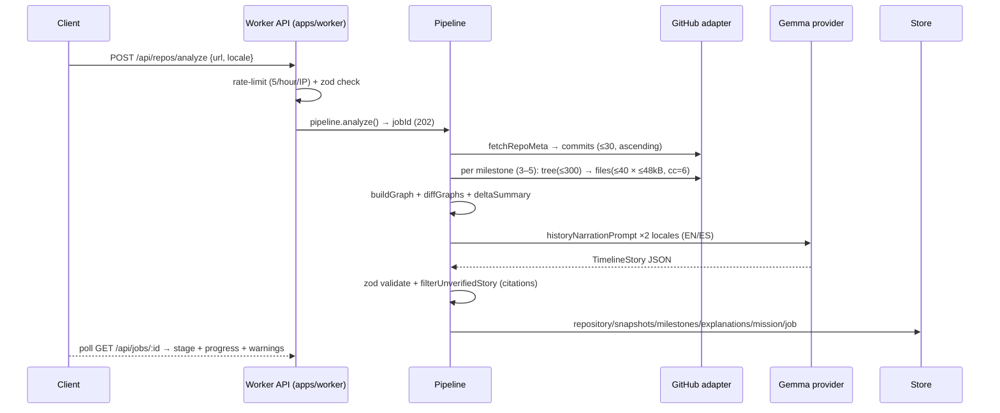

# Architecture

Atlas Bridge turns repository facts into visual, multilingual Git-history
stories. This page describes how a request travels through the system
(TRD §4) and how the monorepo is organized (TRD §10.3).

## Data path

```
Browser → API/BFF → auth+rate-limit → ingestion queue → GitHub adapter
        → fact extraction → immutable graph/snapshot store
        → Gemma analysis jobs → validated explanation store → UI
```

- Mission services read the **same** snapshot/provenance data.
- PR actions use a **separate, OAuth-gated** mutation path
  (`packages/pipeline/src/contribution.ts`) — it is disabled by default and
  only reachable when an explicit `GITHUB_WRITE_TOKEN` is configured
  (TRD §7, §14: preview-only at the demo gate).

## Services and invariants (TRD §4.1, as built)

| Service | Implementation | Critical invariant |
| --- | --- | --- |
| Repo ingestion | `packages/pipeline/src/analysis.ts` + `packages/github` | Deterministic bounded retrieval; URL allowlist + SSRF guard; no private access by default |
| Fact graph | `packages/graph` (`buildGraph`, `diffGraphs`) | Deterministic edges; `inferred` flag separates unproven relationships (TRD §4.1) |
| Timeline | `analysis.ts` (`chooseMilestones`, `pickBoundedFiles`) | Every milestone maps to a real SHA; 3–5 milestones; no gap-flattening |
| AI orchestrator | `packages/ai` + `explanations.ts` | Only cited evidence enters claims; zod validation after `generateJson`; cache key = SHA+locale+level (TRD §12) |
| Localization | `packages/ai` prompts + web dictionaries | SHAs, paths, identifiers never translated; EN/ES both generated (FR-05) |
| Learning engine | `packages/learning` (`checkMission`, `mergeProgress`) | Fully deterministic scoring — never model self-evaluation (TRD §5.2) |
| Contribution gateway | `pipeline/src/contribution.ts` | Never pushes without explicit user confirmation; OAuth token opt-in only |
| Persistence | `packages/store` (memory + Postgres) | JSONB documents matching `@atlas/contracts` entities 1:1 (`infra/postgres/schema.sql`) |

## Bounded analysis flow (TRD §4.2)



Job stages surface progress: `validate-url 5 → fetch-meta 10 → fetch-commits
20 → milestones 30 → ingest-graphs 70 → ai-story 85 → seed-missions 95 →
persist 100` (TRD §6.1). Rate-limit hits degrade to `partial`/`rate-limited`
snapshot states with a visible warning instead of failing the whole job
(TRD §8: partial recovery beats an indefinite spinner).

## Monorepo layout (TRD §10.3)

```
apps/web       Next.js UI (routes per TRD §2.2)
apps/worker    GitHub ingestion, milestone builder, AI jobs, REST §6.1
packages/ui    (design tokens, accessible components)
packages/contracts   zod schemas + entities — single source of truth
packages/github      read/write-separated GitHub adapters + fixtures
packages/graph       AST/import graphs, milestone + delta engines
packages/ai          Gemma providers, prompts, offline fallback
packages/learning    mission/rubric engine (deterministic)
packages/store       memory + Postgres stores
packages/pipeline    orchestration: analysis, explanations, missions,
                     contributions, fixture ingestion
infra/         docker-compose (Postgres, Redis), schema.sql
docs/          architecture, privacy, deployment, contributing
```

Cross-package traffic goes only through `@atlas/*` imports; `packages/pipeline`
consumes the other packages through the contracts published in
`packages/contracts` so all agents/PRs stay glue-code compatible.

## Design decisions worth knowing

- **Graphs are process-cached, not persisted.** `Store` has no graph API in
  v1; the worker keeps `GraphSnapshot`s in memory for hot paths. A restart
  requires a cheap re-analysis; `pipeline.graph()` returns a clear error
  until graphs are reloaded (TRD §4.2).
- **Fixture-first demo.** The curated fixture (`octokit-request-js.json`, generated
  by `npm run seed`) is used only when the analyzed URL matches the fixture
  repository; everything else goes live (TRD §10.1.2, §11).
- **Offline fallbacks are labeled.** When no model is reachable, stories are
  generated deterministically from diff facts and flagged `offline: true`;
  the summary explicitly says it is a fallback (TRD §11: never disguise
  recordings as live inference).
- **Citations are validated twice.** Story-level
  `filterUnverifiedStory` drops any `evidenceRef` whose SHA/path is absent
  from retrieved facts (TRD §5.3). The AI surface mirrors this
  determinism so no fabricated claim can render (TRD §8: 100% citations
  resolve, or the claim is not shown).
